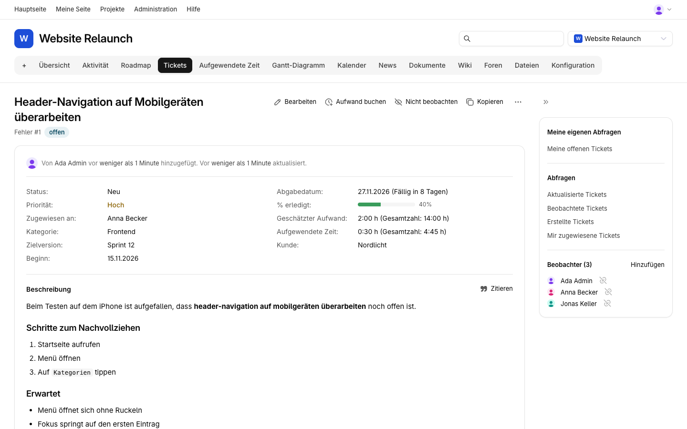
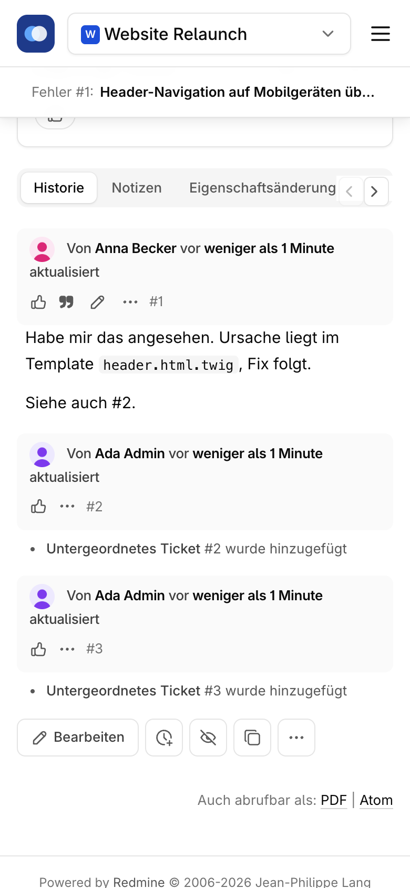
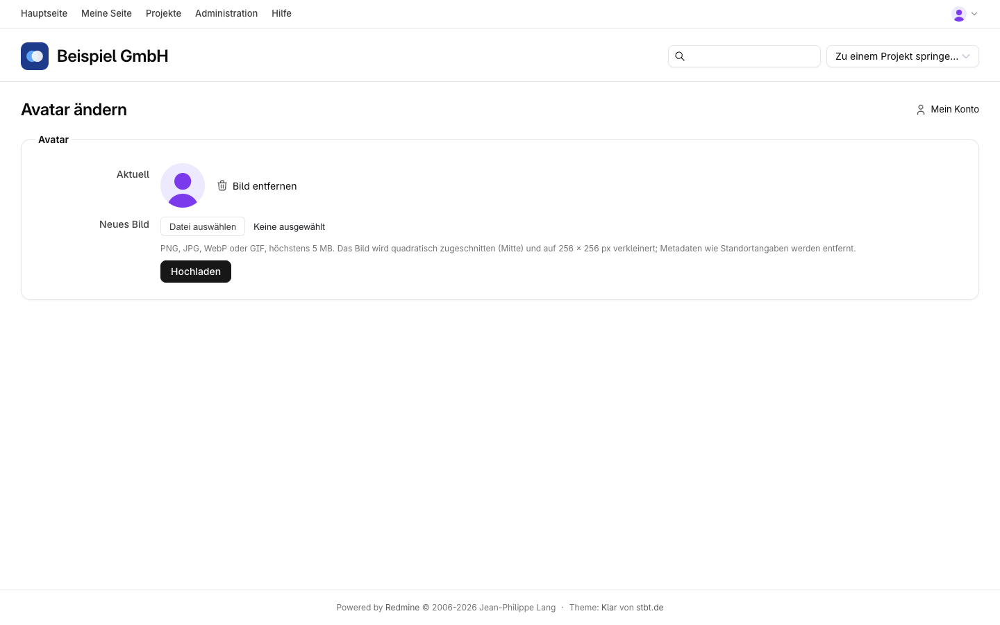

# Avatars – your own profile pictures for Redmine

Redmine shows either initials or pictures from Gravatar. With Gravatar, every page view
loads images from an external server and sends it a hash of the user's e-mail address.
This plugin lets users upload their own picture instead – stored on your own server:

- **Upload under *My account* → *Change avatar*:** PNG, JPG, WebP or GIF, up to 5 MB.
- **Administrators** manage the picture of any user under *Administration → Users*.
- **Cropped and resized automatically:** square (centre), 256 × 256 px PNG; metadata such
  as location data from phone photos is removed.
- **Shown everywhere Redmine shows an avatar:** issues, journals, watchers, lists, the
  account menu.
- **Without a picture nothing changes:** Redmine keeps showing initials or Gravatar.

Works with any theme. With [Klar](https://github.com/stbt-de/redmine-klar-theme) the
pictures are round like the initials.

## Screenshots

*Shown with the [Klar theme](https://github.com/stbt-de/redmine-klar-theme) and example data.*

| Issue with author and watchers | Journal on mobile |
| --- | --- |
|  |  |

Uploading a picture under *My account → Change avatar*:



## Installation

The folder in `plugins/` must be named `redmine_avatars`.

**Release zip:** download `redmine-avatars-v*.zip` from the
[releases](https://github.com/stbt-de/redmine-avatars/releases) and unpack it in the
`plugins/` directory (it contains the folder `redmine_avatars/`).

**Or clone:**

```
cd /path/to/redmine/plugins
git clone https://github.com/stbt-de/redmine-avatars.git redmine_avatars
```

Restart Redmine. No database migration is needed. The pictures are processed with
ImageMagick (`convert`), which Redmine already uses for thumbnails; the official Redmine
Docker image includes it.

### Tested with

| Redmine | Ruby | Rails | Checked |
| --- | --- | --- | --- |
| 7.0.3 | 4.0.10 | 8.1.4 | integration tests; in the browser with the themes Default and Klar (desktop, mobile) |
| 6.1.6 | 3.4.13 | 7.2.4 | integration tests |
| 6.0.12 | 3.3.14 | 7.2.3.2 | integration tests |

The plugin requires Redmine 6.0 or later. The interface is available in English and
German.

## How it works

- Pictures are stored in Redmine's files directory (`files/redmine_avatars/`) and are
  therefore backed up together with attachments. The file name and checksum are kept in
  the user's preferences.
- They are served at `/avatars/<user id>` only to users who may see that user; Redmine's
  "Authentication required" setting applies. Browsers may cache them privately; a new
  picture gets a new URL.
- The file type is detected from the content, not the name. Only raster formats are
  accepted (no SVG), and only those are passed to ImageMagick – without a shell and
  with Redmine's thumbnail timeout.
- When a user is deleted, their picture is deleted too.
- An uploaded picture takes precedence over Gravatar and initials.

## Development

Tests run against a fresh Redmine in a container (Docker required):

```bash
dev/run-tests.sh                        # Redmine 7.0
REDMINE_VERSION=6.1 dev/run-tests.sh    # another version
```

Code comments are written in German.

## Built with AI assistance

This plugin was developed together with an AI coding assistant. Most of the code was
written by the assistant; the direction, design decisions and review came from
[stbt.de](https://stbt.de/). Every feature is covered by integration tests and was
checked in a running Redmine.

## License

MIT, see [`LICENSE`](LICENSE).
